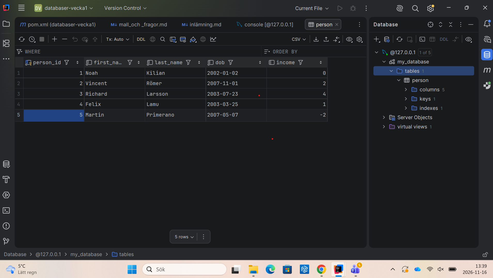
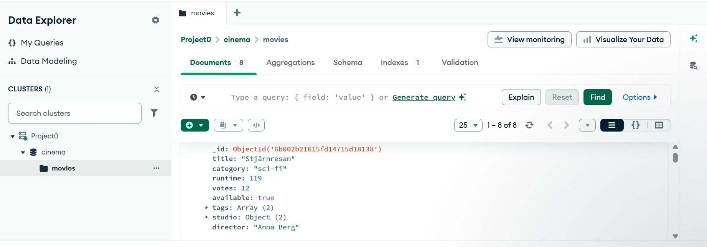
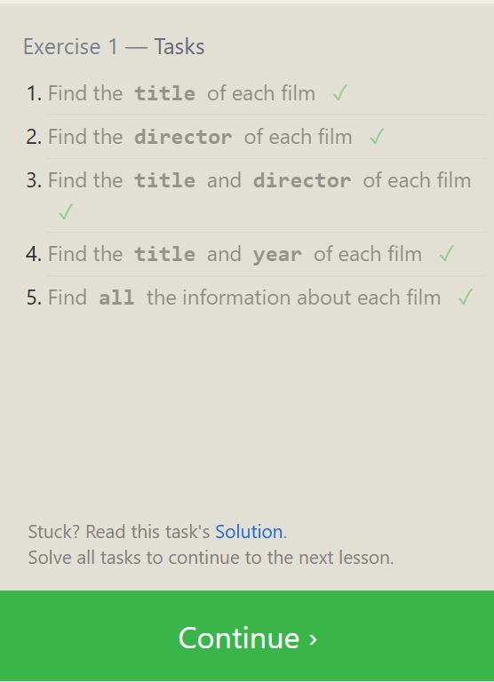
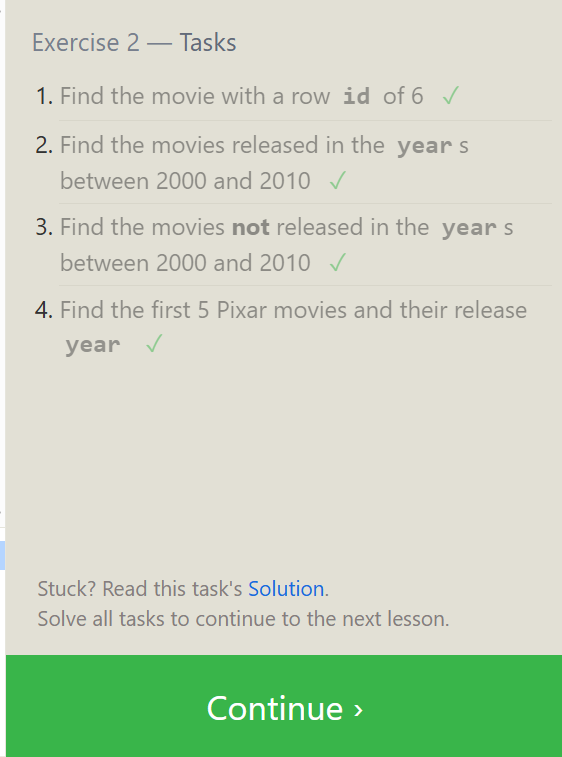

# Bild av MySQL TABLE

# Bild av MongoDB

Fick försent reda på att man inte kan ändra namn på ett cluster så den heter nu Project0 istället fär movie-collection.

# SQLbolt 1 och 2

# Frågor Svar:

1. En databas lagrar information effektivt och lätt åtkomligt. Man kan lagra saker som Personuppgifter, produkter eller
   beställningar/leveranser.

2. SQL används för att prata med databaser. till exempel för att addera information till databasen, ta bort information
   eller hämta information.

3. En tabell är ett sätt att visa information där en rad (horisontellt) är ett objekt med all info om objektet, och en
   kolumn (vertikalt) är alla kategorier av info.

4. En primärnyckel är den kategorin som ska vara unik för varje objekt och behövs bland annat så att du alltid kan hitta
   det objekt du söker efter även om annan information om obejkten är samma.

5. En främmande nyckel är en kategori i en tabell som refererar till en primärnyckel i en annan tabell.

6. Det är mer effektivt, mindre information behöver lagras och det är mycket mer lättläsligt.

7. NoSQL databaser lagrar information i andra format än tabeller som till exempel JSON, eller nyckel-värde-par som en
   map i programmering.

8. En NoSQL databas är bättre för stora mängder information och för att den inte har en bestämd struktur utan kan ändras
   och ha olika strukturer beroende på behov.

# SQL frågor svar:

9. SELECT * FROM personer;

10. SELECT förnamn, efternamn FROM personer;

11. SELECT förnamn, efternamn, inkomst FROM personer WHERE inkomst > 30000;

12. SELECT * FROM personer WHERE dob < '1990-01-01';

13. SELECT förnamn, efternamn, inkomst FROM personer ORDER BY inkomst DESC;

14. SELECT COUNT (*) FROM person;
